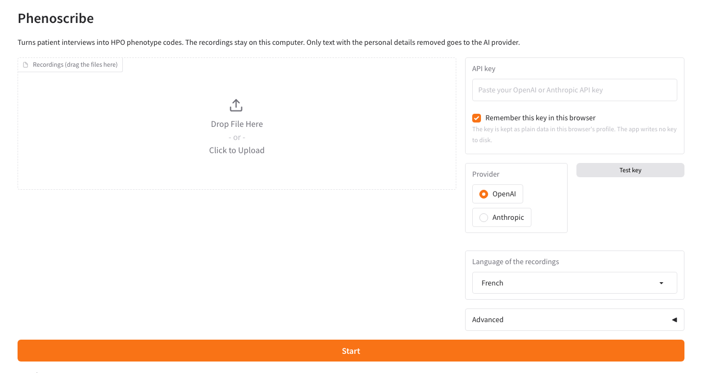

# Install Phenoscribe

This page is for people who do not use a command line. You type no commands.
The first start takes 10 to 40 minutes, because the app downloads and prepares its parts
one time. A slow laptop takes longer.

## What you need

- A Mac with Apple Silicon (M1 or newer). An Intel Mac does not work: the app needs
  packages that do not exist for it. Windows is not supported yet.
  To check a Mac, open the Apple menu → **About This Mac**: the **Chip** line names M1, M2…
- About 12 GB of free disk space.
- An internet connection.
- An API key from OpenAI or Anthropic. The AI step uses it, at about $0.01 for each recording.
  See [Get an API key](#get-an-api-key).

## 1. Download and extract

1. Go to <https://github.com/tarikjamoulle/phenoscribe/releases/latest>.
2. Under **Assets**, click `Phenoscribe.zip`. The file goes to your **Downloads** folder.
3. Open **Downloads** in Finder.
4. If you see a `Phenoscribe` folder, Safari extracted the ZIP for you. If you see only
   `Phenoscribe.zip`, double-click it. The `Phenoscribe` folder appears next to it.
5. Drag the `Phenoscribe` folder to your **Documents** folder, and open it.

## 2. Double-click the start file

In `Documents/Phenoscribe`, double-click `Start Phenoscribe.command`.

Tip: make a shortcut on the desktop. Hold **Option + Cmd** and drag the file to the desktop.

A window with text opens. The first time, it downloads Python, the packages, the
speech model (3 GB), the privacy models for French, Dutch and English (2.1 GB) and the
HPO ontology, and builds the search index. Each later start
skips this and opens the page in about 30 seconds. Keep this window open while you use the
app. Close it to stop the app.

The first time, the Mac can show a warning ("cannot be opened"), because the start file is
not signed. Open **System Settings → Privacy & Security**, scroll down, and click
**Open Anyway**. Then double-click the file again.

The speech step runs on the Apple chip's GPU only when the free program
`ffmpeg` is installed. Without it, the app works the same but transcribes about 4 times
slower. To get help with the install, open an issue on the GitHub repository.

You own your laptop, so you can always pass this warning. An antivirus program can also
ask about the start file or about `uv` (the tool that installs Python). Allow it.

## 3. Paste your API key

The browser opens on the Phenoscribe page (<http://127.0.0.1:7860>).



Paste your key in the **API key** box, then click anywhere outside the box. The app
makes one small call to check the key. When the key works, the box folds into one line
("OpenAI key works"). If the key is wrong, the page says "Key rejected".

The app selects OpenAI or Anthropic from the key. With **Remember this key in this
browser** ticked, you paste the key one time only. The browser keeps it as plain data in
your browser profile. The app writes no key to disk. Click **Change key** to use another key.

## 4. Add your files and click Start

1. Drag your files onto the box, or click **Choose a folder** to add a whole folder.
   - Audio files (`.mp3`, `.wav`, `.m4a`, `.ogg`, `.flac`) are transcribed first.
   - Transcripts (`.txt` or Word `.docx`) are read as they are. A `001.txt` next to
     `001.mp3` is used in place of the audio. Old Word files (`.doc`) are skipped: save
     them as `.docx` in Word.
   - A recording that the app already transcribed is not transcribed again. To make a new
     transcript, tick the file under **Transcribe again**.
   - Other files are skipped. The list under the box says what happens to each file.
2. Check the language of the interviews. French is the default. The language also picks
   the privacy models that remove the personal details: French, Dutch and English each have
   their own model plus a multilingual model. German, Spanish and Italian get the
   multilingual model only.
3. Choose what to do:
   - **Remove personal details, then find HPO codes**: this needs the API key.
   - **Remove personal details only**: this needs no key. No text leaves the computer.
4. Under **Also remove**, untick a type to keep it in the text: dates, ages, gender or job
   titles. Names, places, organizations, phones, emails and ID numbers are always removed.
5. Click **Start**. Transcription takes about as long as the recording, longer without a
   GPU. The progress bar shows the file and the step.

## 5. Check the doubtful files

The app approves each file with no blocking warning sign. You check only the doubtful files. A file
is doubtful when:

- a word after a title stays in the text, for example "docteur Vandermeulen";
- a first name or a town stays in the clean text, for example "Claire" or "Namur" (the
  leak check);
- the app is unsure about a value that it removed, and only one model read the file
  (Dutch without DEDUCE, German, Spanish, Italian). With two models (French, English,
  Dutch with DEDUCE), the value is removed already and the file goes on.

The list shows the files to check first, each with its reasons. For each file, the page
shows:

- a count line, for example "6 removed: 3 phones · 2 names · 1 date";
- the text, with each removed value colored by type;
- a table with one row for each value and the number of times it appears.

Check the file, then click **Approve**:

- **Untick** a value that is not a personal detail, for example a drug name. It goes back
  at every place in the text.
- Under **Possibly missed**, tick a word after a title, a first name or a town to remove it
  everywhere. If the word is not a personal detail, leave it and approve the file.
- Type any other missed word under **Remove a word the app missed**, then click
  **Remove it**.

To skip the checks, click **Approve the N waiting files with no check**, then confirm. A file
with a possible name left in the text stays: open it and approve it yourself. You can
open any approved file from the **File** list and change it. A change needs a new approval.

The app can miss details, also in a file with no warning. A name that it missed goes to the
AI provider. Each change is saved: you can close the page and continue later.

When the files are approved:

- **Find HPO codes in N approved files** sends only the approved clean text to the AI
  provider. The page then shows the number of codes, one line for each file, and the coded
  findings. Click **Download Excel**, or click **To review** to see only the codes to check.
- **Save N clean texts** makes a ZIP with the clean texts and a counts report. A Word file
  gets a clean Word copy too. The copy keeps the text and loses the layout.

Each run makes a new Excel file, for example `results_2026-10-22_1405.xlsx`, in the
folder `Documents/Phenoscribe results`. A file named only with a number (`001.mp3`) gets that number
as its patient ID. Any other file name gets a code such as `pt-7a4b3c8e`, because file names can
hold patient names. The file `filename_mapping.json` in the same folder links each code to
its file name. Two files that give the same patient ID in one run (for example `001.mp3`
from two folders) are both skipped. Rename one of them.

The Excel file also shows when each finding comes up in the interview. The columns
**First Mention %** and **Last Mention %** give the place (0 % = start, 100 % = end), and
**Mentions** gives how many times it comes up. The **Mentions** sheet has one row for each
time, in interview order, with the time (`mm:ss`) when the transcript has time markers.

The clean texts go to the `clean` folder. The Excel file has a **Personal details** sheet
with the counts for each patient. No real name goes in the Excel file or the ZIP.

The real names stay on this computer, in the `review` and `transcripts` folders and in
`filename_mapping.json`. The Excel sheet and the report say how each file was approved:
`checked`, `auto: no warning` or `approved in bulk`.

If a file fails, the page shows one short line for it ("Key rejected", "No internet",
"Audio format not supported"). The full details go to `phenoscribe.log` in the same folder.
If every file fails, the app makes no Excel file, and the page says so.

## Personal details

The removal of personal details is automatic and can miss a name. Phenoscribe shows you the
files that it doubts. Open a file in the review if you want to check it.

- The AI provider (OpenAI or Anthropic) gets only the clean text. Each removed value has a
  placeholder there, for example `PERSON_1`. The audio, the transcript and the real names
  stay on this computer.
- French, Dutch and English have their own model plus a multilingual model. German,
  Spanish and Italian get the multilingual model only.
- On 5 synthetic interviews for each language, the app removed 38 of 42 details in French,
  46 of 49 in Dutch and 47 of 47 in English. Five interviews is a small check. Real
  interviews can give less. Dutch has less protection: an optional install (DEDUCE, see
  the README) removed 49 of 49.
- A file with a possible name left in the text never goes to the AI provider until you
  approve it in the review.
- The **Provenance** sheet of each Excel file names the privacy models and repeats this
  warning.

## Update

1. Close the Phenoscribe window.
2. Download the new ZIP (step 1) and delete the old app folder (`Phenoscribe` in
   **Documents**).
3. Extract the new ZIP at the same place, then double-click the start file.

Your results and saved transcripts stay in `Documents/Phenoscribe results`, outside the app
folder, so you lose nothing. The speech model stays on the computer too. The first start
after an update rebuilds the search index, so it takes some minutes.

## Get an API key

You need one key, from OpenAI or from Anthropic.

- OpenAI: create an account at <https://platform.openai.com/signup>, add credit under
  **Settings → Billing** ($5 is enough to test), then create a key at
  <https://platform.openai.com/api-keys>. The key starts with `sk-`.
- Anthropic: create an account at <https://console.anthropic.com/>, add credit under
  **Settings → Billing**, then create a key under **Settings → API Keys**. The key starts
  with `sk-ant-`.

Copy the key when you create it. You cannot see it again later.

## Problems

| What you see | What to do |
|---|---|
| The window closes or says "Phenoscribe stopped with an error" | Copy the last 20 lines of the window and open an issue on the GitHub repository with them. |
| "Key rejected" | Paste the key again, or make a new key. With OpenAI, check that you have credit. |
| "No internet" | Check the connection, then click **Find HPO codes** again. |
| "The AI account has no credit left, or hit its limit" | Add credit on the provider's billing page (OpenAI needs prepaid credit), wait a few minutes, then click **Find HPO codes** again. |
| A line that starts with "Failed" | Open an issue on the GitHub repository. Add the last lines of `phenoscribe.log` from `Documents/Phenoscribe results`, without patient names. |
| The browser does not open | Open <http://127.0.0.1:7860> yourself. |
| The page opens on another address, for example <http://127.0.0.1:7861> | Phenoscribe already runs in another window. Use that window, or close it first. |

Help: open an issue at <https://github.com/tarikjamoulle/phenoscribe/issues>.

## Docker (for Linux servers)

The image is not built or tested yet. For a Linux server, use Docker. The build runs `phenoscribe setup`, so the image holds the models and the index
(about 12 GB).

```bash
docker build -t phenoscribe .
mkdir -p output
docker run --rm -p 127.0.0.1:7860:7860 -v "$(pwd)/output:/app/output" phenoscribe
```

The results go to the `output` folder. The app in the container runs as user ID 1000, so
that user ID must be able to write to `output`.

Open <http://localhost:7860> and drop the files on the page. The `127.0.0.1:` part of `-p`
keeps the page closed to other computers on the network. Docker on a Mac cannot use the
Mac GPU, so transcription is slower there than with the start file.
