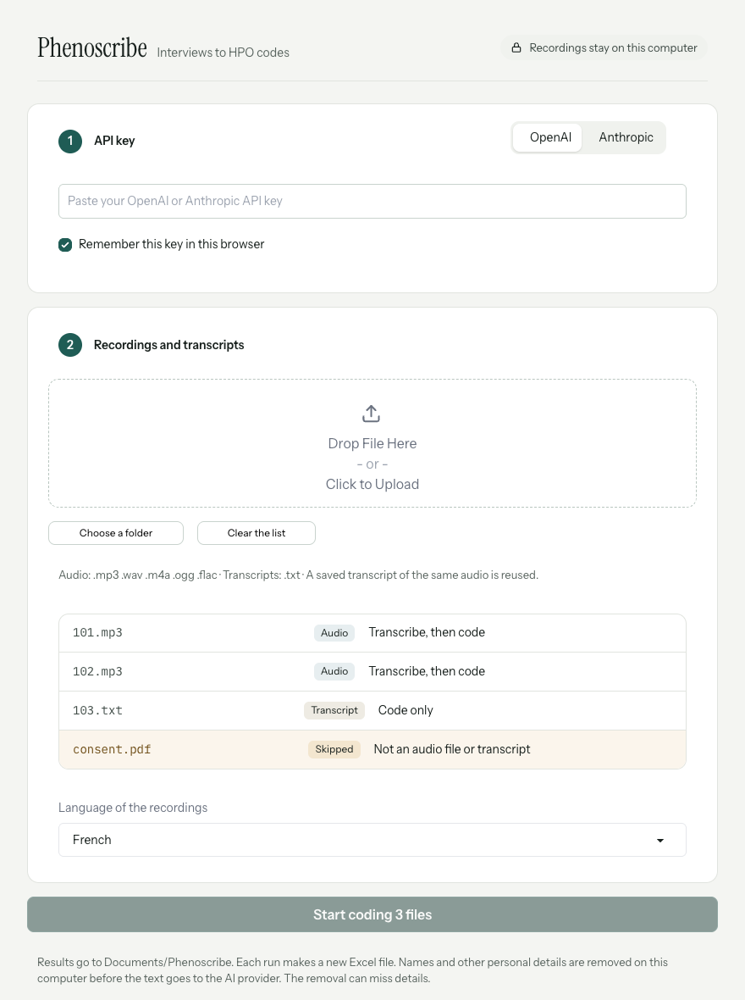

# Install Phenoscribe

This page is for people who do not use a command line. You type no commands.
The first start takes 10 to 20 minutes, because the app downloads its parts one time.

## What you need

- A laptop with Windows 10/11 (64-bit, Intel or AMD) or a Mac.
- About 10 GB of free disk space.
- An internet connection.
- An API key from OpenAI or Anthropic. The AI step uses it, at about $0.01 for each recording.
  See [Get an API key](#get-an-api-key).

## 1. Download

1. Go to <https://github.com/tarikjamoulle/phenoscribe/releases>.
2. Under the newest release, click `Phenoscribe.zip`.
3. Extract the ZIP:
   - Windows: right-click the file, then **Extract All**. Extract it to a short path, for
     example `C:\Phenoscribe`. A long path can go past the Windows path-length limit.
   - Mac: double-click the file. Move the `Phenoscribe` folder to your **Documents** folder.

## 2. Double-click the start file

- Windows: open the folder and double-click `Start Phenoscribe.bat`.
- Mac: open the folder and double-click `Start Phenoscribe.command`.

A window with text opens. The first time, it downloads Python, the packages, the
speech model (3 GB) and the HPO ontology. Each later start skips these downloads.
Keep this window open while you use the app. Close it to stop the app.

The first time, your computer can show a warning, because the start file is not signed:

- Windows SmartScreen ("Windows protected your PC"): click **More info**, then **Run anyway**.
- Mac ("cannot be opened"): open **System Settings → Privacy & Security**, scroll down,
  and click **Open Anyway**. Then double-click the file again.

You own your laptop, so you can always pass these warnings. An antivirus program can also
ask about the start file or about `uv` (the tool that installs Python). Allow it.

## 3. Paste your API key

The browser opens on the Phenoscribe page (<http://127.0.0.1:7860>).



Paste your key in the **API key** box, then click anywhere outside the box. The app
makes one small call to check the key. When the key works, the box folds into one line
("OpenAI key works"). If the key is wrong, the page says "Key rejected".

The app selects OpenAI or Anthropic from the key. With **Remember this key in this
browser** ticked, you paste the key one time only. The browser keeps it as plain data in
your browser profile. The app writes no key to disk. Click **Change key** to use another key.

## 4. Add your files and click Start

1. Drag your files onto the box, or click **Choose a folder** to add a whole folder.
   - Audio files (`.mp3`, `.wav`, `.m4a`, `.ogg`, `.flac`) are transcribed, then coded.
   - Transcripts (`.txt`) are coded as they are. A `467.txt` next to `467.mp3` is used in
     place of the audio.
   - A recording that the app already transcribed is not transcribed again. To make a new
     transcript, tick the file under **Transcribe again**.
   - Other files are skipped. The list under the box says what happens to each file.
2. Check the language. French is the default.
3. Click **Start coding**. The progress bar shows the file and the step.
4. When the run ends, the page shows the number of codes, one line for each file, and the
   coded findings. Click **Download Excel**, or click **To review** to see only the codes
   to check.

Each run makes a new Excel file, for example `results_2026-10-22_1405.xlsx`, in the
folder `Documents/Phenoscribe`. A file named only with a number (`467.mp3`) gets the patient
ID `MGA.467`. Any other file name gets a code such as `pt-7a4b3c8e`, because file names can
hold patient names. The file `filename_mapping.json` in the same folder links each code to
its file name. Two files that give the same patient ID in one run (for example `467.mp3`
from two folders) are both skipped. Rename one of them.

If a file fails, the page shows one short line for it ("Key rejected", "No internet",
"Audio format not supported"). The full details go to `Documents/Phenoscribe/phenoscribe.log`.

## Update

Download the new ZIP and replace the old folder. Your results stay in
`Documents/Phenoscribe`, outside the app folder, so you lose nothing.

## Get an API key

You need one key, from OpenAI or from Anthropic.

- OpenAI: create an account at <https://platform.openai.com/signup>, add credit under
  **Settings → Billing** ($5 is enough to test), then create a key at
  <https://platform.openai.com/api-keys>. The key starts with `sk-`.
- Anthropic: create an account at <https://console.anthropic.com/>, add credit under
  **Settings → Billing**, then create a key under **Settings → API Keys**. The key starts
  with `sk-ant-`.

Copy the key when you create it. You cannot see it again later.

## Problems

| What you see | What to do |
|---|---|
| The window closes or says "Phenoscribe stopped with an error" | Copy the last 20 lines of the window and send them to Tarik. |
| "Key rejected" | Paste the key again, or make a new key. With OpenAI, check that you have credit. |
| "No internet" | Check the connection, then click **Start** again. |
| The browser does not open | Open <http://127.0.0.1:7860> yourself. |
| "Cannot find empty port" | Phenoscribe already runs in another window. Use that window, or close it first. |

Help: open an issue at <https://github.com/tarikjamoulle/phenoscribe/issues>, or email Tarik.

## Docker (for Linux servers)

Linux users can also use the start file (`sh "Start Phenoscribe.command"`). For a server,
use Docker. The build runs `phenoscribe setup`, so the image holds the models and the index
(about 10 GB).

```bash
docker build -t phenoscribe .
docker run --rm -p 127.0.0.1:7860:7860 \
  -e PHENOSCRIBE_OUTPUT_DIR=/data/output \
  -v "$(pwd)/output:/data/output" \
  phenoscribe
```

Open <http://localhost:7860> and drop the files on the page. The `127.0.0.1:` part of `-p`
keeps the page closed to other computers on the network. Docker on a Mac cannot use the
Mac GPU, so transcription is slower there than with the start file.
